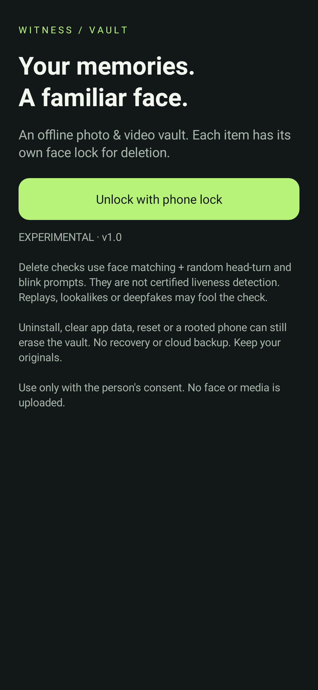

# Witness Vault

An offline Android photo and video vault organized into **face-keyed folders**.
Each folder is created from one clear enrollment photo. Anything can be added to
a folder freely. Deleting any item, or a whole folder, asks for that folder's
face in a fresh front-camera check.

**Experimental v1.2. Not a security-certified biometric product.**



## Install

Download `Witness-Vault-v1.2-arm64.apk` from this repository's **v1.2 release**.
Open the APK on the Android phone and allow installation for the browser/files
app if Android asks. No Windows setup is needed to use the app.

- Android 8.0 or newer, 64-bit ARM phone, front camera.
- Set a phone PIN, pattern or password first.
- No account, subscription, card or model download.
- Keep the same app signing key for updates. Do not uninstall to update a vault
  that contains files you still need.

## First test, use a disposable file

1. Open Witness Vault and unlock with the phone's screen lock.
2. Tap **+ New folder**. Give it a name and choose one clear, straight-on face
   photo, with both eyes open and no other faces. Get the person's consent. This
   enrolls that face for this folder only.
3. Open the folder, tap **Add media** and choose one or more disposable videos
   or photos. Long-press in the picker to select several at once.
   Confirm the phone lock when returning from the system picker. Wait for the
   save confirmation. The original stays in the gallery. Files up to 512 MB are
   supported.
4. View it and confirm it plays/displays correctly.
5. Tap **DELETE** on the item and show your face to the front camera. Try a
   different person's face: it should not complete. Cancel and check the item is
   still there.
6. Try a printed/photo-on-screen image of the enrolled person. A still photo
   should not pass. Then try the enrolled person in good light, looking straight
   at the camera. Successful deletion removes only this vault copy, never the
   original gallery file.
7. Try **Delete folder** from the folder screen. It asks for the same live face
   check and warns that everything inside is destroyed.

If the enrolled person cannot finish, keep the originals and report where the
check stopped. Matching is conservative and the same person can be rejected
because of lighting, pose, glasses, aging, photo quality or camera quality.
There is no PIN or owner override for in-app deletion, and no face-lock reset.
Face enrollment cannot be changed after folder creation; create a new folder
instead. Renaming a folder is always free.

## What it protects, and what it does not

- AES-256-GCM protects media and face templates in app-private, no-backup storage.
  Media uses authenticated 64 KB chunks, bound to the item ID and order, with an
  authenticated terminator to detect truncation.
- The encryption key is generated in Android Keystore. Hardware backing depends
  on the phone and is not assumed.
- Each delete needs a fresh, single-use, item-bound check, expiring after 45
  seconds. The app first matches the live face against the folder's enrolled
  FaceNet template, then requires a natural blink within the same check. The
  screen only asks you to show your face; it never reveals that blinking is
  being measured.
- Because the blink is required but never prompted, a still photo of the
  enrolled person cannot pass on its own. A short blinking **video** of the
  enrolled person could pass: this is a raise-the-bar check, not certified
  liveness detection.
- The phone's normal screen lock gates viewing and access, not deletion. The
  camera face gate cannot be replaced by fingerprint/PIN inside this app.
- Camera-only checks are **not certified liveness detection**. Replayed videos,
  deepfakes, twins/lookalikes or a compromised camera/device may defeat them.
  No guarantee that only the exact real person can ever delete.
- A person controlling Android settings can **uninstall, clear app data, reset
  the phone or remove files on a rooted/compromised device**, bypassing the
  app's delete screen and destroying the vault. An ordinary app cannot prohibit
  this.
- No cloud backup or recovery is offered. Device loss, app removal, key loss or
  corruption can permanently lose these copies. Keep originals elsewhere.
- Enrollment from a photo does not prove consent or identity. Enroll only
  people who agree to this use.

The app requests camera access only. It has no Internet permission. Face images
are not retained after enrollment; their encrypted templates are. Viewing creates
an app-private temporary decrypted copy, removed on leaving the viewer and at next
startup after a crash. This is not secure erasure of flash storage. Screen capture
and recent-app previews are blocked through Android's `FLAG_SECURE`, subject to
Android/device behavior.

## Verification status

See [TEST_REPORT.md](TEST_REPORT.md) for exact automated results and limits.
On-phone install, camera matching, real spoof resistance, Keystore behavior,
playback and manufacturer-specific lifecycle behavior still need device testing.
The screenshots are rendered native Android views under host-side UI tests, not
proof of a physical-phone test. Displayed test media cards are synthetic UI data.

## Source / Windows developer build

Install Android Studio with JDK 17 and Android SDK 35. Open this project and use
**Build APK(s)**. Or, from PowerShell with the SDK configured:

```powershell
.\gradlew.bat testDebugUnitTest lintDebug assembleDebug
```

Debug builds use a separate test signing identity. Do not install them over a
release vault or uninstall an existing vault to switch identities.

For a signed release, restore the private signing backup outside the project and
set `WITNESS_KEYSTORE` and `WITNESS_SIGNING_PASSWORD_FILE` to its local paths, then
run `gradlew.bat assembleRelease`. The signing key is not in Git history or APK.
The encrypted maintenance backup is saved separately. Never upload it here.

Optional real-device developer tests: `gradlew.bat connectedDebugAndroidTest` on
a disposable test installation. These were prepared but have not been run.

[Third-party notices and model attribution](NOTICE.md) · Apache-2.0
