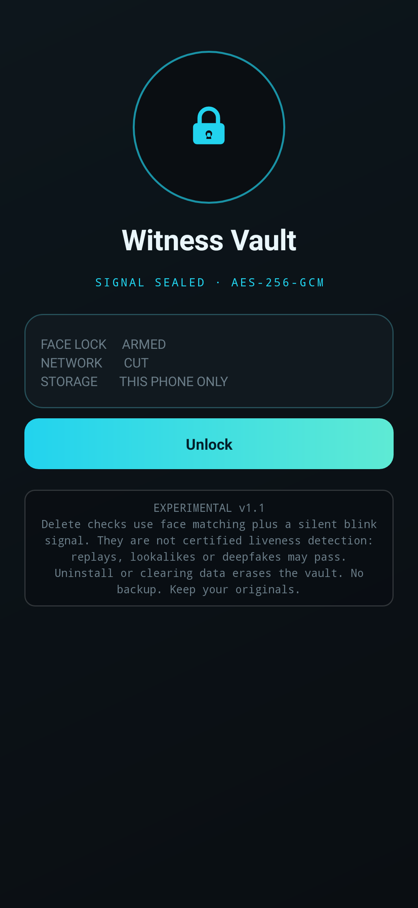
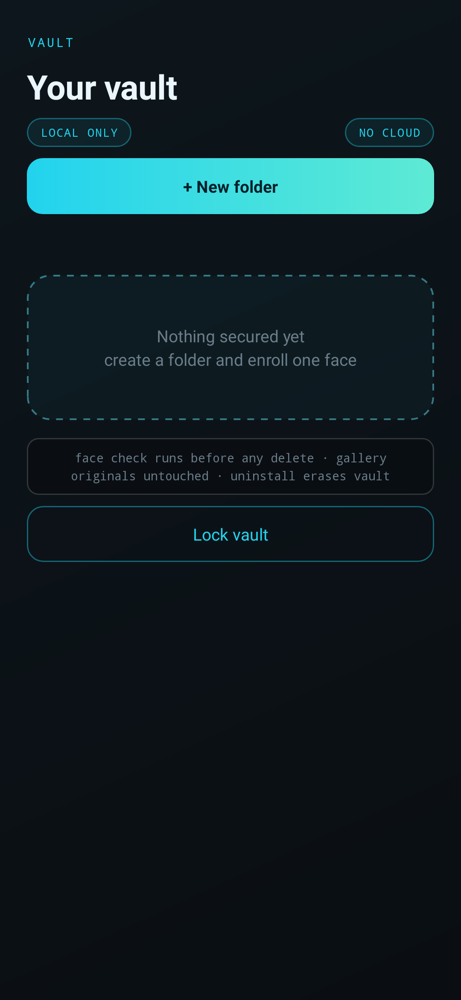
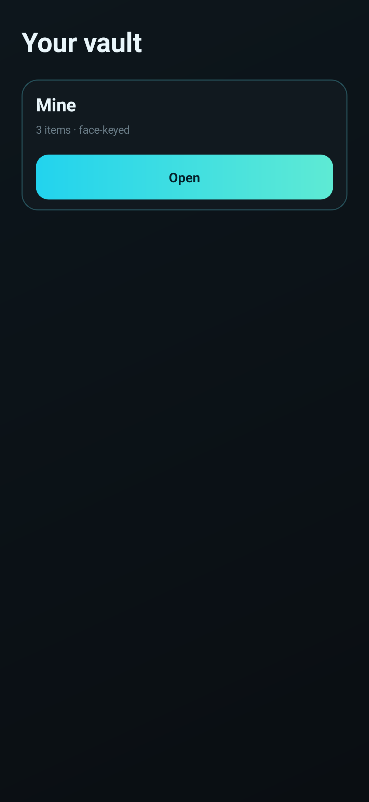
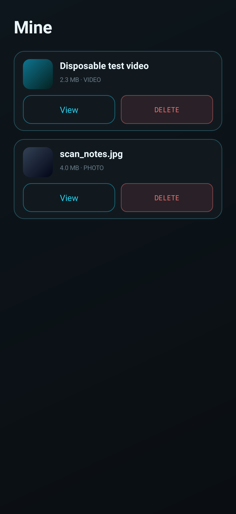

# v1.1 verification report

22 November 2026. Experimental build, not biometric security certification.

Changes since v1.0: the vault is now organized into face-keyed folders, and the
delete check is a two-step sequence: live face match against the folder's
enrolled template, then a silent blink requirement. The screen only says "Show
your face"; it never reveals that blinking is measured, so a still photo of the
enrolled person cannot pass on its own. Head turns were removed. New "Ghost"
dark interface. Whole-folder deletion runs the same live check and warns first.

## Passed

- Signed, non-debuggable Android release APK built with SDK 35, minimum SDK 26,
  ARM64 native libraries. APK Signature Scheme v2 verified. Same release
  certificate as v1.0, so v1.1 installs as an update over v1.0.
- 39 host-side automated tests, zero failures/errors:
  - 16 challenge-state tests: two-step face-match-then-blink sequence, wrong-face
    reset, still-photo/no-blink non-completion, multiple/missing faces, invalid
    scores, duplicate timestamps, cancellation, 45 s timeout, item binding,
    minimum-duration and single-use proofs. These supply synthetic detector
    observations, not physical photo attacks.
  - 14 encryption-format tests: single/multiple/empty chunk roundtrips, random
    IVs, unreadable payload, changed bytes, missing terminator/chunks, extra
    bytes, wrong key/item/type, corrupt header and reordered chunks. Host JCA,
    not a phone's Keystore.
  - 4 RGBA buffer tests, including padded camera rows with no padding after the
    final row, malformed stride and truncated input rejection.
  - 5 host Android UI/lifecycle tests: locked screen, empty vault, folder card,
    item cards and background relocking. Native view rendering at phone size.
- Visually inspected locked, empty-vault, folder-card and item-card native-view
  renders. No clipped controls or overlapping text; Ghost cyan accent applied
  consistently, including the app icon on the locked screen.
- Release manifest inspected. Camera is the only dangerous permission. A
  signature-scoped AndroidX internal receiver permission is also present. No
  Internet or broad storage permission.
- FaceNet model file unchanged from v1.0 (same SHA-256). The v1.0 bundled-model
  CPU smoke comparison stands: same-person cosine 0.8052 vs different-person
  0.0142/-0.0433, threshold 0.78. Three photos cannot establish accuracy,
  fairness or false-accept/reject rates.

## Not verified on an actual Android phone

Installation, actual Android Keystore, system credential/file-picker lifecycle,
bundled ML Kit + TFLite together, front-camera orientation/format, frame rate,
challenge usability, media codecs, OEM background behavior and screenshot
blocking. Prepared DeviceSmokeTest instrumentation tests compile but have NOT
been run.

Use a disposable file first. Test a different live person, a still photo (must
fail), the enrolled person, a separate fresh check for a second item, a whole-
folder delete, leaving/reopening the app and video playback.

## Security limits

No certified presentation-attack detection. The silent blink raises the bar
against still photos, but a short blinking video of the enrolled person could
pass. No depth/IR sensor guarantee or measured resistance to video replay,
deepfakes or adaptive spoofing. Landmark predictions and face matches can be
wrong. The same person can fail because of the conservative threshold, pose or
light, and a wrong person can match because recognition is probabilistic.

An Android owner can bypass the app's delete screen by uninstalling, clearing
app data, resetting, or using a rooted/compromised device. Ordinary apps cannot
make local files undeletable. Gallery originals remain outside this vault,
unchanged. No backup or recovery. Keep originals.

## File identity

- APK: Witness-Vault-v1.1-arm64.apk
- APK SHA-256: `5bc260d32cbbf5e4d48f6961b0761c5679716a0b674ce23d92f73b67af9d8474`
- Signing certificate SHA-256: `801b639fbb210106c5e74948859c6d9999a8b62b669c49f8ba49fa3a76f2df67` (unchanged from v1.0)
- FaceNet SHA-256: `d7c1f7f130376982c7004920ddc41925ac2e5aecf6522f476c8bbb3669db7013` (unchanged from v1.0)

The private release key is backed up outside the repository. This is not a
public debug key. Source is not obfuscated; security does not rely on hidden
code or thresholds.

## Screenshots

Host native-view renders, not a physical-device run. Cards use synthetic UI data.

## Sources

- https://developer.android.com/training/data-storage/app-specific
- https://developers.google.com/ml-kit/vision/face-detection/android
- https://github.com/shubham0204/FaceRecognition_With_FaceNet_Android
- https://github.com/serengil/deepface/tree/master/tests/unit/dataset
