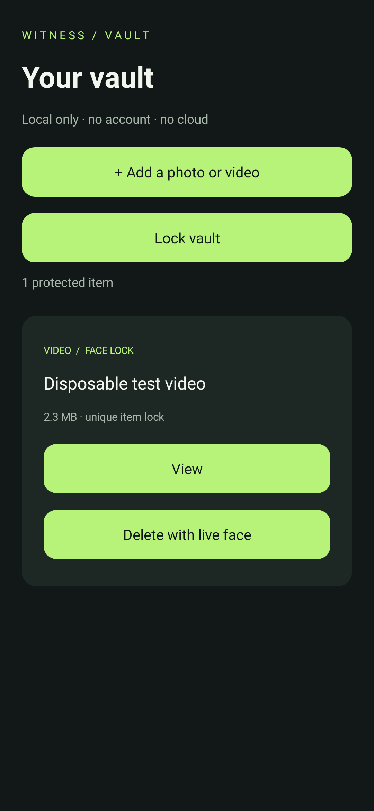

# v1.0 verification report

22 November 2026. Experimental build, not biometric security certification.

## Passed

- Signed, non-debuggable Android release APK built with SDK 35, minimum SDK 26, ARM64 native libraries. APK Signature Scheme v2 verified.
- 37 host-side automated tests, zero failures/errors:
  - 15 challenge-state tests: valid sequences, random direction support, wrong-face reset, still-photo/no-blink non-completion, multiple/missing faces, invalid scores, duplicate timestamps, cancellation, timeout, item binding and single-use proofs. These supply synthetic detector observations, not physical photo attacks.
  - 14 encryption-format tests: single/multiple/empty chunk roundtrips, random IVs, unreadable payload, changed bytes, missing terminator/chunks, extra bytes, wrong key/item/type, corrupt header and reordered chunks. Host JCA, not a phone's Keystore.
  - 4 RGBA buffer tests, including padded camera rows with no padding after the final row, malformed stride and truncated input rejection.
  - 4 host Android UI/lifecycle tests: locked screen, empty vault, synthetic media card and background relocking. Native view rendering at phone size.
- Android Lint: zero errors, 15 warnings, mostly newer dependencies, portrait orientation and localization.
- Release manifest inspected. Camera is the only dangerous permission. A signature-scoped AndroidX internal receiver permission is also present. No Internet or broad storage permission.
- Bundled FaceNet CPU smoke test: two public test photos of one person and a third photo of a different person. Same-person cosine 0.8052; different-person cosines 0.0142 and -0.0433. Threshold 0.78. Host OpenCV face boxes + TFLite, not camera/ML Kit. Three photos cannot establish accuracy, fairness or false-accept/reject rates.
- Visually inspected locked, empty-vault and synthetic media-card native-view renders. No clipped controls or overlapping text.

## Not verified on an actual Android phone

Installation, actual Android Keystore, system credential/file-picker lifecycle, bundled ML Kit + TFLite together, front-camera orientation/format, frame rate, challenge usability, media codecs, OEM background behavior and screenshot blocking. Prepared DeviceSmokeTest instrumentation tests compile but have NOT been run.

Use a disposable file first. Test a different live person, a static photo, the enrolled person, a separate fresh check for a second item, leaving/reopening the app and video playback.

## Security limits

No certified presentation-attack detection. No depth/IR sensor guarantee or measured resistance to video replay, deepfakes or adaptive spoofing. Head-turn order has only two variations. Landmark predictions and face matches can be wrong. The same person can fail because of the conservative threshold, pose or light, and a wrong person can match because recognition is probabilistic.

An Android owner can bypass the app's delete screen by uninstalling, clearing app data, resetting, or using a rooted/compromised device. Ordinary apps cannot make local files undeletable. Gallery originals remain outside this vault, unchanged. No backup or recovery. Keep originals.

## File identity

- APK: Witness-Vault-v1.0-arm64.apk
- APK SHA-256: `7356d16172511b36afc9c5c43af5c2a3841b50abbc1529aebb0ba53cd7ee5f54`
- Signing certificate SHA-256: `801b639fbb210106c5e74948859c6d9999a8b62b669c49f8ba49fa3a76f2df67`
- FaceNet SHA-256: `d7c1f7f130376982c7004920ddc41925ac2e5aecf6522f476c8bbb3669db7013`

The new private release key is backed up outside the repository. This is not a public debug key. Source is not obfuscated; security does not rely on hidden code or thresholds.

## Screenshots

Host native-view renders, not a physical-device run. The media card uses synthetic UI data.

## Sources

- https://developer.android.com/training/data-storage/app-specific
- https://developers.google.com/ml-kit/vision/face-detection/android
- https://github.com/shubham0204/FaceRecognition_With_FaceNet_Android
- https://github.com/serengil/deepface/tree/master/tests/unit/dataset
